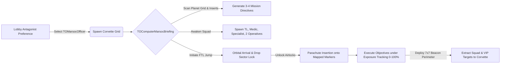

<div align="center">

# Colonial-Marine: Custom Gameplay Systems (ECS Showcase)

**Tactical Special Operations, Dynamic Colony Objectives, Augmented Reality HUD, and Field Robotics built on the RobustToolbox ECS Engine**

[](#3-engine-architecture-and-ecs-solutions)
[](#3-engine-architecture-and-ecs-solutions)
[](#4-repository-file-structure)

[Overview](#overview) |
[MARSOC Operations](#1-marsoc-special-operations-module) |
[Advanced Engineer & Robotics](#2-advanced-engineer-and-field-robotics-module) |
[ECS Architecture Details](#3-engine-architecture-and-ecs-solutions) |
[File Structure](#4-repository-file-structure)

</div>

---

## Legal & Educational Disclaimer

- **Educational & Portfolio Purpose Only:** This project was created strictly for non-commercial, educational, and portfolio purposes to practice C# (.NET 9) software architecture, networked state synchronization, and Entity-Component-System (ECS) design patterns. The project is not monetized and generates no revenue.
- **Attribution & Open-Source Licenses:** Certain visual assets (`.rsi` sprites), audio paths, and base interfaces are adapted from open-source community projects (**Space Station 14** and **Colonial Marines**). Custom source code is provided under the **MIT License**, while derived visual assets remain under their respective **CC-BY-SA 3.0 / CC-BY-NC-SA 3.0** licenses with full credit to the original authors.

---

## Table of Contents

- [Overview](#overview)
- [1. MARSOC Special Operations Module](#1-marsoc-special-operations-module)
  - [1.1. Orbital Corvette, CRT Briefing Console, and FTL Synchronization](#11-orbital-corvette-crt-briefing-console-and-ftl-synchronization)
  - [1.2. Exterior Tile Detection, Paradrop Sectors, and Skyranger Extraction](#12-exterior-tile-detection-paradrop-sectors-and-skyranger-extraction)
  - [1.3. Dynamic Exposure System (0-100%) and Line-of-Sight Optimization](#13-dynamic-exposure-system-0-100-and-line-of-sight-optimization)
  - [1.4. Hybrisa Prospera We-Ya Bunker, Independent Power, and Role Quests](#14-hybrisa-prospera-we-ya-bunker-independent-power-and-role-quests)
  - [1.5. Roster Hierarchy, Custom Ranks, and Specialized Equipment](#15-roster-hierarchy-custom-ranks-and-specialized-equipment)
- [2. Advanced Engineer and Field Robotics Module](#2-advanced-engineer-and-field-robotics-module)
  - [2.1. Decoupled Vendor Architecture (AdvEngineerVendorSystem)](#21-decoupled-vendor-architecture-advengineervendorsystem)
  - [2.2. Augmented Reality Visor and TacticalEngineerHudOverlay](#22-augmented-reality-visor-and-tacticalengineerhudoverlay)
  - [2.3. Autonomous Robotic Units (Driller, Turret, Transporter)](#23-autonomous-robotic-units-driller-turret-transporter)
  - [2.4. Power Management, Blowtorch Repair, and Maintenance Dock](#24-power-management-blowtorch-repair-and-maintenance-dock)
- [3. Engine Architecture and ECS Solutions](#3-engine-architecture-and-ecs-solutions)
  - [3.1. EntityEventBus Ordering Constraints and Proxy Marker Components](#31-entityeventbus-ordering-constraints-and-proxy-marker-components)
  - [3.2. Respecting Upstream Access Restrictions (RA0001 / RA0002)](#32-respecting-upstream-access-restrictions-ra0001--ra0002)
  - [3.3. Dynamic Character Window Objectives via RoleBriefingComponent](#33-dynamic-character-window-objectives-via-rolebriefingcomponent)
  - [3.4. Preventing Pidgin Markup Exceptions in Localized Chat Output](#34-preventing-pidgin-markup-exceptions-in-localized-chat-output)
- [4. Repository File Structure](#4-repository-file-structure)

---

## Overview

This repository showcases custom gameplay mechanics, client-server Entity-Component-System (ECS) modules written in **C# (.NET 9)**, and data prototypes (**YAML / Fluent**) built on the **RobustToolbox** engine. All features are isolated within the `_TacticalOps` and `Showcase` namespaces across `Content.Shared`, `Content.Server`, and `Content.Client` to maintain clean modular boundaries from core `_ColonialMarine` systems and prevent merge conflicts.

---

## 1. MARSOC Special Operations Module

The Marine Forces Special Operations Command (`MARSOC`) module introduces a covert 6-man raider unit operating independently from the main UNMC force aboard the *USS Almayer*. When triggered at roundstart, the system loads an independent orbital corvette grid (`to_marsoc_shuttle.yml`), assigns the roundstart `TOMarsocOfficer` candidate from the Antagonist preference pool, and generates mission objectives tailored to active planetary inserts.



### 1.1. Orbital Corvette, CRT Briefing Console, and FTL Synchronization

Upon initialization of `TOMarsocOfficerComponent`, the system replaces the standard shuttle communications console with `TOComputerMarsocBriefing`.

<div align="center">


*Opening TOComputerMarsocBriefing, inspecting dynamically generated objectives, spawning squad ghost roles, and launching orbital FTL flight*

</div>

**Implementation Highlights:**
- **Dynamic Scenario Detection:** `TOMarsocBriefingSystem` inspects all entities on the target planet grid (`IsPlanetGrid`) and matches prototype signatures against configured `MissionPool` entries (such as the Three Suns Empire Airbase `tse_airbase`, CLF Spaceport `clfspaceport`, Hybrisa research sector, or Trijent Dam).
- **FTL State Synchronization:** Pressing the launch button invokes `ShuttleSystem.FTLToCoordinates`. To prevent audio and visual desynchronization, `TOMarsocBriefingSystem.Update` monitors both the scheduled arrival timestamp and the removal of `FTLComponent` from the shuttle grid before transitioning to `TOMarsocFlightPhase.ArrivedInOrbit` and switching the map parallax.

```csharp
// Content.Server/Showcase/MARSOC/TOMarsocBriefingSystem.cs
var gridUid = xform.GridUid;
var ftlStillActive = gridUid != null && HasComp<FTLComponent>(gridUid.Value);

if (curTime >= comp.FlightArrivalTime && !ftlStillActive)
{
    comp.FlightPhase = TOMarsocFlightPhase.ArrivedInOrbit;
    if (gridUid is { } validGrid)
    {
        _marsoc.CompleteShuttleOrbitalArrival(validGrid, comp.FlightParallax);
        if (comp.SectorLocked)
            _marsoc.SetShuttleParadropState(validGrid, true);
    }

    Dirty(uid, comp);
    UpdateConsoleUi((uid, comp));
}
```

---

### 1.2. Exterior Tile Detection, Paradrop Sectors, and Skyranger Extraction

Shuttle maps pad exterior airlocks with invisible hull tiles (`CMShuttleTileInvisible`). Stepping outside an airlock does not immediately change `TransformComponent.GridUid` to null. `TOMarsocSystem` evaluates the tile definition beneath each operative:

- **Docked in Deep Space (Airlocks Locked):** Stepping onto exterior invisible tiles or space applies lethal blunt trauma.
- **In FTL Transit:** Operatives stepping outside during hyperspace travel are safely teleported back to their interior `ReturnCoordinates`.
- **In Orbit with Paradrop Active:** Stepping out triggers `SharedParaDropSystem.DoParaDrop`, scattering the operative around the locked planetary drop sector.

<div align="center">


*Stepping out of the corvette airlock in orbit, landing at a mapped drop zone marker, deploying the 7x7 flare perimeter, and extracting back to the shuttle*

</div>

**Mapper Drop Zone Markers (`TOMarsocDropZoneComponent`):**
Mappers can place `TOMarsocDropZoneMarkerAlpha`, `Bravo`, `Charlie`, and `Delta` directly onto planet maps. If no markers are present on a map, `EnsureSafePlanetSectors` scans the planet grid for unroofed outdoor surface tiles (`Asphalt`, `Sidewalk`, `Dirt`, `Grass`, `Sand`, `Snow`) positioned at least 24 tiles away from living survivors.

**Tactical Extraction Beacon (`TOMarsocExtractionBeaconComponent`):**
- Usable only on open-sky planet tiles by the Officer, Team Leader, Specialist, or Squad Synthetic.
- Spawns a `7x7` perimeter of burning signal flares (`TOMarsocExtractionFlare`) and grants `TOActionMarsocConfirmExtraction` to squad commanders.
- After a 15-second countdown, extracts all living mobs (including captured VIPs) inside the perimeter back to the corvette, provided at least one living MARSOC operative remains inside the extraction zone.

---

### 1.3. Dynamic Exposure System (0-100%) and Line-of-Sight Optimization

To enforce stealth gameplay and prevent random deathmatch (RDM) against standard UNMC marines, `TOMarsocSystem` tracks a global squad exposure meter from `0%` to `100%`.

| Trigger Event | Exposure Delta | System Event / Condition |
| :--- | :---: | :--- |
| Kill Tier 1 Xenomorph | **+2.5%** | `MobStateChangedEvent` (`XenoComponent.Tier <= 1`) |
| Kill Tier 2 Xenomorph | **+3.0%** | `MobStateChangedEvent` (`XenoComponent.Tier == 2`) |
| Kill Tier 3+ Xenomorph | **+5.0%** | `MobStateChangedEvent` (`XenoComponent.Tier >= 3`) |
| Projectile / Melee Hit on UNMC Marine | **+0.2%** | `DamageChangedEvent` on `TOMarsocTrackedTargetComponent` |
| Kill UNMC Marine | **+4.0%** | `MobStateChangedEvent` (`MarineComponent` without `CMSurvivorComponent`) |
| Sustained Line-of-Sight with UNMC Marine (>6s) | **+1.5% / 3s** | `UpdateExposureLineOfSight` (`_examine.InRangeUnOccluded`, 10-tile radius) |
| MARSOC Operative Death | **+20.0%** | `MobStateChangedEvent` on `TOMarsocOperativeComponent` |

**Line-of-Sight Performance Optimization:**
Instead of running raycasts every tick across all marines on the map, `UpdateExposureLineOfSight` executes once every **3 seconds** and iterates only over living `TOMarsocOperativeComponent` entities on the planet grid (at most 6 entities). It queries a reusable `HashSet<EntityUid>` within a 10-tile radius and checks `_examine.InRangeUnOccluded`. Operatives must remain in unbroken visual contact for 2 consecutive checks (6 seconds) before accumulating exposure penalties.

```csharp
// Content.Server/Showcase/MARSOC/TOMarsocSystem.cs
_losNearbyEntities.Clear();
_lookup.GetEntitiesInRange(opXform.Coordinates, ExposureLosRange, _losNearbyEntities, LookupFlags.Uncontained);

var spottedByMarine = false;
foreach (var other in _losNearbyEntities)
{
    if (other == opUid ||
        !HasComp<MarineComponent>(other) ||
        HasComp<TOMarsocOperativeComponent>(other) ||
        HasComp<CMSurvivorComponent>(other) ||
        _mobState.IsDead(other))
    {
        continue;
    }

    if (_examine.InRangeUnOccluded(opUid, other, ExposureLosRange))
    {
        spottedByMarine = true;
        break;
    }
}
```

**Threshold Consequences:**
- **75% Exposure:** ARES broadcasts a sector-wide alert to UNMC forces warning of unidentified armed operatives operating without transponders.
- **100% Exposure (Mission Compromise):** *USS Almayer* anti-air batteries engage the MARSOC corvette in low orbit. The corvette aborts orbit (permanently locking airlocks and destroying active extraction beacons), and a Weston-Yamada PMC liquidation squad deploys to the surface.

---

### 1.4. Hybrisa Prospera We-Ya Bunker, Independent Power, and Role Quests

On LV-759 Hybrisa Prospera, the Weston-Yamada Executive Bunker serves as a high-value objective hub for MARSOC, Royal Paramarines (`tse_airbase`), and corporate survivors.

**Mechanics Implemented:**
1. **Autonomous Bunker Power Grid:** At roundstart, colony fusion reactors are offline. `RefreshBunkerIndependentPower` locates `CMApcComponent` units and power receivers within the bunker radius, maintains full charge on the APC `"cell"` battery via `BatterySystem.SetCharge`, and sets `NeedsPower = false; Powered = true` on bunker buttons, doors, and vendors.
2. **One-Way Timed Indestructible Shutters (`CMPodDoorHybrisaIndestructibleUltra`):** To prevent players inside the bunker from endlessly toggling indestructible shutters open and closed, `TOMarsocSystem` detaches `CMPodDoorComponent` from bunker shutters on initialization and intercepts `ActivateInWorldEvent` via `TOMarsocBunkerButtonComponent`. Activating the button starts a **3-minute countdown** (or triggers automatically at **10 minutes** of round duration), after which the shutters open permanently.
3. **Corporate Storage Case (`CMPortableVendorCorporate`) and Queen Cryo Pod (`CMPropGiantXenoCryo`):** Interacting with the corporate case dispenses 4 laboratory research logs, the We-Ya Black Ledger, Command Protocols, and a fragile biological sample flask (`TOMarsocAbominationFlask`). All spawned documents are automatically stamped with the official `CMStampWeYa` seal via `PaperSystem.TryStamp`.

---

### 1.5. Roster Hierarchy, Custom Ranks, and Specialized Equipment

The Officer role is configured as a selectable roundstart antagonist (`- type: antag`, `id: TOMarsocOfficer`), while squad members are deployed via shuttle markers (`TOMarsocSpawnMarkerTeamLeader`, `Medic`, `Specialist`, `Operative`).

| Role | Rank & Paygrade | Primary Loadout | Special Capabilities |
| :--- | :---: | :--- | :--- |
| **MARSOC Officer** | Captain / Major (`O3/O4`) | Suppressed `XM40` (AP), `XM38` Shotgun, NVG | Briefing console control, FTL launch, extraction beacon |
| **Team Leader** | Second Lieutenant (`O1`) | Suppressed `XM40` (AP), `XM38` Shotgun, NVG | Custom `TORankMarsocSecondLt` rank, beacon deployment & confirmation |
| **Specialist** | Second Lieutenant (`O1`) | Suppressed `L112` Anti-Materiel Rifle, Sniper Armor | Custom `hudsquad_socsniper` icon, sniper/scout whitelist, beacon deployment |
| **Combat Medic** | Staff Sergeant (`E6`) | Suppressed `XM40` (AP), `TOBeltMedicalMarsocFilled` | Custom `hudsquad_socmed` icon, 12-slot belt with 3 defibrillators, hypospray, `CMSurgicalLine`, `CMSynthGraft` |
| **Operative (x2)** | Staff Sergeant (`E6`) | Suppressed `XM40` (AP), `XM38` Shotgun | Demolition and grenade specialist whitelists |

[Back to top](#table-of-contents)

---

## 2. Advanced Engineer and Field Robotics Module

The Advanced Engineer module expands marine engineering gameplay with heavy protective gear, an Augmented Reality structural/robotics visor, and three buildable autonomous robot classes.

### 2.1. Decoupled Vendor Architecture (`AdvEngineerVendorSystem`)

Upstream `CMAutomatedVendor` overwrites ID card titles with hardcoded abbreviations. To avoid modifying upstream vendor logic, `TOAdvEngineerVendorComponent` and `AdvEngineerVendorSystem` listen to `AfterItemVendedEvent`, dynamically updating the player's ID card title (`_idCard.TryChangeJobTitle`) and applying the custom role prefix.

---

### 2.2. Augmented Reality Visor and `TacticalEngineerHudOverlay`

The tactical engineering helmet features an integrated welding shield and an AR visor backed by `TacticalEngineerHudOverlay` and `TacticalEngineerHudSystem`.

<div align="center">


*Toggling the Advanced Engineer AR visor, viewing real-time health, battery charge, and state telemetry above Driller, Turret, and Transporter bots*

</div>

**Viewport Filtering in Overlay Rendering:**
When rendering custom overlays using both `WorldSpace` and `ScreenSpace`, secondary camera viewports (such as `SentryLaptopWindow`) can clear the primary screen render queue. `TacticalEngineerHudOverlay` filters out secondary viewports by verifying the active `EyeComponent`:

```csharp
// Content.Client/_TacticalOps/AdvanceEngiHUD/TacticalEngineerHudOverlay.cs
if (!_entity.TryGetComponent<EyeComponent>(player, out var playerEye) || playerEye.Eye != eye)
    return;
```

---

### 2.3. Autonomous Robotic Units (Driller, Turret, Transporter)

Engineers can fabricate and deploy three specialized robot types using custom circuitboards (`to_circuitboard_drill.yml`, `to_circuitboard_turret.yml`, `to_circuitboard_transporter.yml`) and skill validation (`TacticalRequiresSkillCondition.cs`):

1. **Driller Bot (`BotDrillerSystem` / `TacticalBotDrillerComponent`):** Uses server-side pathfinding (`NPCSteeringSystem.Register`) to breach walls and mine mineral veins. Checks `EntityWhitelistSystem.IsBlacklistPass` and `ReceiverXenoClawsComponent` to distinguish standard walls from reinforced hulls, applying `Structural` damage with `ignoreResistances: true`.
2. **Combat Turret Bot (`BotTurretSystem` / `TacticalBotTurretComponent`):** Evaluates targets using `GunIFFSystem.IsInFaction` (`FactionMarine`) and `_examine.InRangeUnOccluded` before engaging hostile entities, while reporting status updates via `BotAnnouncementSystem`.
3. **Transporter Bot:** Moves construction materials and supply crates between logistics hubs and frontline fortifications.

<div align="center">


</div>

---

### 2.4. Power Management, Blowtorch Repair, and Maintenance Dock

- **Bot Battery System (`TacticalBotBatterySystem` / `TacticalBotBatteryComponent`):** Tracks power draw across idle, movement, and combat states, with circuitboard damage handling upon critical hull failure.
- **Welder Repair Integration:** Fully compatible with `CMRepairableSystem`, requiring an active `BlowtorchComponent` (`ItemToggleComponent.Activated == true`) fueled with `CMWeldingFuel` in the `"Welder"` solution container.
- **Maintenance Dock:** Stationary recharge and repair station utilizing `[AutoGenerateComponentPause]` and `SimpleDoAfterEvent`.

[Back to top](#table-of-contents)

---

## 3. Engine Architecture and ECS Solutions

### 3.1. `EntityEventBus` Ordering Constraints and Proxy Marker Components

RobustToolbox's `EntityEventBus` enforces two strict registration rules at startup:
1. Two systems cannot subscribe to the same `(TComponent, TEvent)` pair (`Duplicate Subscriptions` exception).
2. All subscriptions to the same `TEvent` within a single `EntitySystem` must declare identical `before:` and `after:` ordering arrays (`UpdateOrderSeq` exception).

**Solution:**
Instead of subscribing directly to `CMDoorButtonComponent`, `MarineComponent`, or `XenoComponent` where upstream systems already register handlers, `TOMarsocSystem` attaches lightweight proxy components (`TOMarsocBunkerButtonComponent`, `TOMarsocTrackedTargetComponent`) and aligns all `ActivateInWorldEvent` subscriptions under a unified ordering constraint:

```csharp
SubscribeLocalEvent<TOMarsocBunkerButtonComponent, ActivateInWorldEvent>(OnBunkerDoorButtonActivate, before: [typeof(CMDoorSystem)]);
SubscribeLocalEvent<TOMarsocCryoPodObjectiveComponent, ActivateInWorldEvent>(OnCryoPodActivate, before: [typeof(CMDoorSystem)]);
SubscribeLocalEvent<TOMarsocCorporateCaseComponent, ActivateInWorldEvent>(OnCorporateCaseActivate, before: [typeof(CMDoorSystem)]);
```

---

### 3.2. Respecting Upstream Access Restrictions (`RA0001` / `RA0002`)

Upstream components such as `CMApcComponent` and `CMPodDoorComponent` restrict write access via `[Access]` attributes. Direct mutation of fields like `apc.MainBreakerButton` or `podDoor.Id` triggers compiler error `RA0002`.

**Solution:**
- Bunker power is maintained by accessing the APC's `"cell"` container and invoking `BatterySystem.SetCharge` on the contained `BatteryComponent`, paired with `ApcPowerReceiverComponent` state updates.
- Bunker shutters are decoupled from `CMDoorSystem` by calling `RemComp<CMPodDoorComponent>(controlledDoor)` after caching their `EntityUid` references in `_bunkerControlledDoors`.

---

### 3.3. Dynamic Character Window Objectives via `RoleBriefingComponent`

To display round-specific directives inside the Character Information window (`C` key) for MARSOC operatives, Royal Paramarines, the Executive Supervisor, and the Assistant Manager (replacing the default *"You have no special roles"* text), `SetPlayerCharacterBriefing` locates the `MindRoleComponent` entity parented to the player's `Mind` and attaches `RoleBriefingComponent` (`Content.Server.Roles`):

```csharp
var roleQuery = EntityQueryEnumerator<MindRoleComponent, TransformComponent>();
while (roleQuery.MoveNext(out var roleUid, out _, out var roleXform))
{
    if (roleXform.ParentUid != mindId)
        continue;

    var rb = EnsureComp<RoleBriefingComponent>(roleUid);
    rb.Briefing = briefingText;
    Dirty(roleUid, rb);
    break;
}
```

---

### 3.4. Preventing `Pidgin` Markup Exceptions in Localized Chat Output

`IChatManager.ChatMessageToOne` parses outgoing strings on the client using `FormattedMessage.AddMarkupOrThrow`. Any unescaped square brackets containing colons (e.g., `[SYNTH: ACTIVE]`) are misinterpreted by the `Pidgin` parser as malformed BBCode tags, crashing the client. All dynamic strings in `_TacticalOps` are sanitized via `FormattedMessage.EscapeText(...)` prior to dispatch.

[Back to top](#table-of-contents)

---

## 4. Repository File Structure

```text
├── Content.Shared/_TacticalOps/
│   ├── AdvEngi/
│   │   └── TOAdvEngineerVendorComponent.cs
│   ├── AdvanceEngiHUD/
│   │   └── Components/
│   │       └── TacticalEngineerHudComponent.cs
│   ├── Construction/
│   │   └── Conditions/
│   │       └── TacticalRequiresSkillCondition.cs
│   ├── MARSOC/
│   │   ├── SharedTOMarsocSystem.cs
│   │   ├── TOMarsocBriefingComponents.cs
│   │   ├── TOMarsocBriefingConsoleComponent.cs
│   │   ├── TOMarsocBunkerControllerComponent.cs
│   │   ├── TOMarsocComponents.cs
│   │   └── TOMarsocDropZoneComponent.cs
│   └── Robotics/
│       ├── TacticalBotBatteryComponent.cs
│       ├── TacticalBotBatterySystem.cs
│       ├── TacticalBotDrillerComponent.cs
│       └── TacticalBotTurretComponent.cs
├── Content.Server/Showcase/
│   ├── AdvEngi/
│   │   └── System/
│   │       └── AdvEngineerVendorSystem.cs
│   ├── MARSOC/
│   │   ├── TOMarsocBriefingSystem.cs
│   │   └── TOMarsocSystem.cs
│   └── Robotics/
│       ├── BotAnnouncementSystem.cs
│       ├── BotDrillerSystem.cs
│       └── BotTurretSystem.cs
├── Content.Client/_TacticalOps/
│   ├── AdvanceEngiHUD/
│   │   ├── TacticalEngineerHudOverlay.cs
│   │   └── TacticalEngineerHudSystem.cs
│   └── MARSOC/
│       ├── TOMarsocBriefingBui.cs
│       ├── TOMarsocBriefingWindow.xaml
│       ├── TOMarsocBriefingWindow.xaml.cs
│       └── TOMarsocClientSystem.cs
└── Resources/
    ├── Locale/
    │   ├── en-US/_TacticalOps/
    │   │   └── construction.ftl
    │   └── ru-RU/
    │       ├── _TacticalOps/
    │       │   ├── construction.ftl
    │       │   ├── to_marsoc.ftl
    │       │   └── job/
    │       │       └── adv_engineer.ftl
    │       └── ss14-ru/prototypes/_tactical_ops/entities/objects/weapons/cases/adv_engi/
    │           └── adv_engineer_items.ftl
    ├── Prototypes/
    │   ├── _ColonialMarine/Entities/Objects/Misc/
    │   │   └── to_adv_engineer_manual.yml
    │   └── _TacticalOps/
    │       ├── Dataset/
    │       │   └── to_marsoc_callsigns.yml
    │       ├── Entities/
    │       │   ├── Clothing/
    │       │   │   ├── Back/to_adv_engineer_backpack.yml
    │       │   │   ├── Belt/to_adv_engineer_belt.yml
    │       │   │   ├── Eyes/to_adv_engineer_visor.yml
    │       │   │   ├── Head/Helmets/to_adv_engineer_helmet.yml
    │       │   │   └── OuterClothing/
    │       │   │       ├── to_adv_engineer_armor.yml
    │       │   │       └── to_marsoc_clothing.yml
    │       │   ├── Markers/
    │       │   │   └── to_marsoc_markers.yml
    │       │   ├── Mobs/Bots/
    │       │   │   └── to_bots.yml
    │       │   ├── Objects/
    │       │   │   ├── Devices/to_marsoc_beacon.yml
    │       │   │   ├── Misc/
    │       │   │   │   ├── to_circuitboard_drill.yml
    │       │   │   │   ├── to_circuitboard_transporter.yml
    │       │   │   │   └── to_circuitboard_turret.yml
    │       │   │   └── Weapons/
    │       │   │       ├── Cases/Adv_engi/to_adv_engineer_cases.yml
    │       │   │       └── Guns/Rifles/to_marsoc_rifles.yml
    │       │   └── Structures/Machines/Computers/
    │       │       └── to_marsoc_computers.yml
    │       └── Roles/Jobs/Other/
    │           └── to_marsoc_jobs.yml
    └── Textures/
        ├── _ColonialMarine/Interface/job_icons/UNMC/marsoc.rsi/
        └── _TacticalOps/
            ├── Interface/MarsocPortraits/
            ├── Mobs/Robots/
            │   ├── TODrillbot.rsi/
            │   ├── TOHoverbot.rsi/
            │   ├── TOTransporter.rsi/
            │   └── TOTurret.rsi/
            └── Objects/
                ├── Clothing/
                │   ├── Back/Backpacks/Humans/TOBackpacks.rsi/
                │   ├── Eyes/TOEngiHud.rsi/
                │   └── Head/Helmets/TOHelmets.rsi/
                └── Misc/TOCircuitboard.rsi/
```
